# oxchart

See which files of a JavaScript or TypeScript project import which.

Give oxchart the file your app starts from. It follows every import, draws the graph
as a picture and opens it. Here in the [zustand](https://github.com/pmndrs/zustand)
repository:

```console
$ oxchart src/index.ts
opened /var/folders/.../T/oxchart-zustand.svg
3 modules, 3 imports, 0 not found, 0 problems in files, in 3.15ms (build 702.50µs, render 2.38ms)
```

The summary goes to stderr. It ends with the time taken: to build the graph, then to
write or draw it.

Here is all of zustand v5.0.16, with its packages:



```console
$ oxchart src/index.ts src/vanilla.ts src/middleware.ts src/middleware/immer.ts \
  src/shallow.ts src/traditional.ts --externals leaf -o zustand.svg
18 modules, 18 imports, 0 not found, 0 problems in files, in 10.27ms (build 2.64ms, render 7.41ms)
```

When the output is piped, it writes the [Mermaid](https://mermaid.js.org) chart
instead, to paste on GitHub or in [mermaid.live](https://mermaid.live):

```console
$ oxchart src/index.ts | head -4
flowchart LR
  m0["src/index.ts"]:::file
  m1["src/react.ts"]:::file
  m2["src/vanilla.ts"]:::file
3 modules, 3 imports, 0 not found, 0 problems in files, in 560.42µs (build 491.04µs, render 9.04µs)
```

Or draw it right in the terminal:

```console
$ oxchart src/index.ts --format ascii
┌──────────────┐              ┌──────────────┐              ┌────────────────┐
│              │              │              │              │                │
│ src/index.ts ├──re-export──►│ src/react.ts ┝━━━static━━━━►│ src/vanilla.ts │
│              │              │              │              │                │
└──────────────┘              └──────────────┘              └────────────────┘
        │                                                            ▲
        └─────────────────────────re-export──────────────────────────┘
3 modules, 3 imports, 0 not found, 0 problems in files, in 3.75ms (build 656.92µs, render 3.05ms)
```

## Install

```sh
cargo install oxchart
```

## Use

```sh
oxchart src/index.ts                    # open a picture of your own files
oxchart src/main.ts --externals leaf    # also show packages, one node each
oxchart src/index.ts --max-depth 2      # stop two imports away from the start
oxchart src/index.ts --edges all        # also follow import() and import type
oxchart src/index.ts -o graph.svg       # save the picture instead of opening it
oxchart src/index.ts -o graph.png       # also .jpg and .pdf
oxchart src/index.ts -o graph.mmd       # Mermaid chart, for GitHub or mermaid.live
oxchart src/index.ts --format ascii     # draw the chart in the terminal
oxchart 'src/pages/**/*.tsx'           # start from every matching file
```

With `-o`, the file extension picks the format: `.svg`, `.png`, `.jpg`, `.pdf`, or
`.txt` for the text drawing. Anything else, like `.mmd`, is the Mermaid chart.
`--format svg|png|jpeg|pdf|mermaid|ascii` always wins.

Run `oxchart --help` for every option.

By default oxchart:

- starts from your `package.json`'s `exports["."]`, `main` or `bin` when no entrypoint is given
- follows `import`, `export ... from` and `require()`, but not `import()` or `import type`
- reads the scripts of `.vue`, `.svelte` and `.astro` files (`<script>` and frontmatter)
- hides npm packages and runtime modules (`node:fs`, `bun:sqlite`...)
- uses the nearest `tsconfig.json` of each file for path aliases like `@/utils`
- picks the Node build of packages (add `--condition-names browser` for a browser app)

Missing imports and syntax errors are warnings: the graph is still built.

## Settings file

Put an `oxchart.toml` in your project to stop retyping flags. oxchart looks for it
in the current folder, then in each parent folder. Flags win over the file.

```toml
entrypoints = ["src/index.ts"]
exclude = ["**/*.test.ts"]
externals = "leaf"
edges = ["static", "re-export", "require"]
max-depth = 4
```

Paths in the file start from the file's folder.

## Library

```sh
cargo add oxchart --no-default-features             # the graph only
cargo add oxchart --no-default-features -F render   # plus the Mermaid chart
```

The default `cli` feature builds the `oxchart` command and pulls in everything it needs.

```rust
let mut config = oxchart::Config::new(["src/index.ts"]);
config.max_depth = Some(3);

let graph = oxchart::build_graph(&config)?;
for edge in graph.edges() {
    println!("{:?} -> {:?}", graph.module(edge.from), graph.module(edge.to));
}

// The Mermaid chart, or a drawing of it like `Format::Svg`.
oxchart::render(&graph, oxchart::Format::Mermaid, &mut std::io::stdout())?;
```

`render` needs the `render` feature, for the Mermaid chart. Each drawing also needs the
feature of its name, which turns on `render`: `svg`, `ascii`, `png`, `jpeg` or `pdf`.

## Credits

- [oxc](https://oxc.rs) by the [VoidZero](https://voidzero.dev) team: `oxc_parser`
  reads the files and `oxc_resolver` finds the imported files. oxchart is a thin layer
  on their work.
- [merman](https://crates.io/crates/merman): oxchart writes a Mermaid chart, and
  merman draws it in every other format: SVG, PNG, JPEG, PDF and text.

## License

MIT
